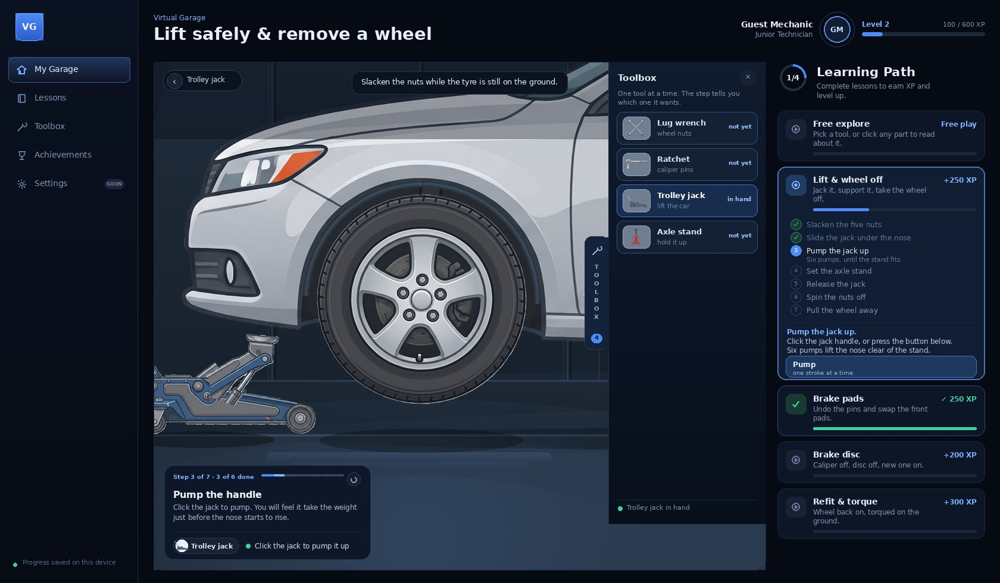
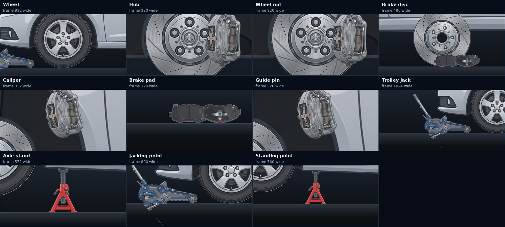
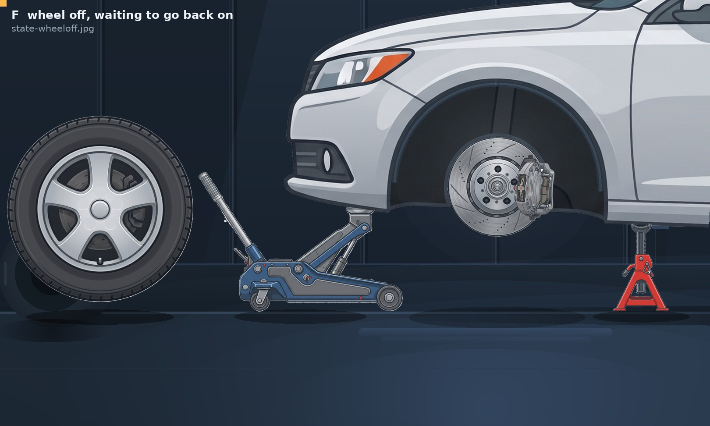
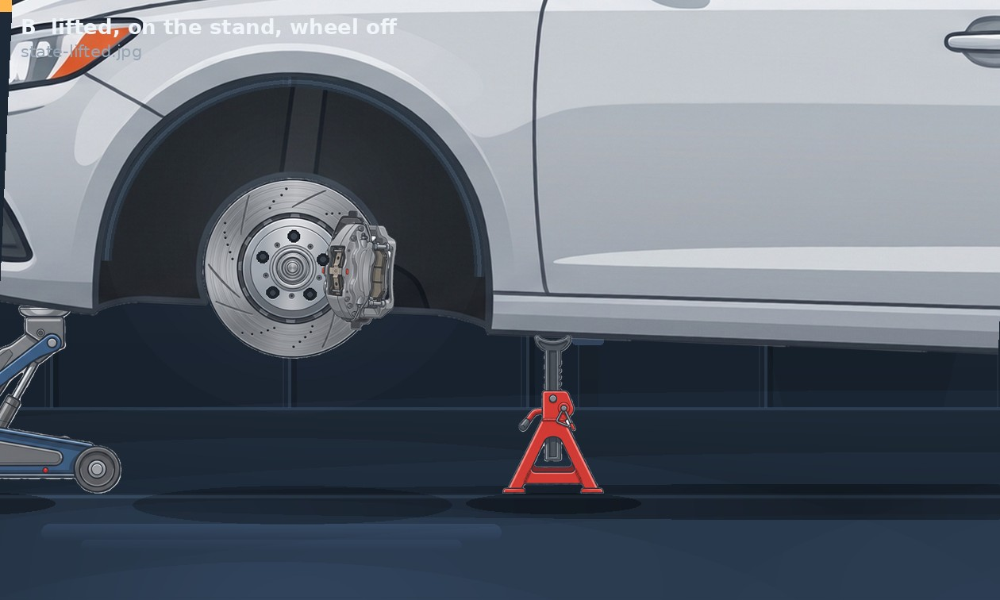
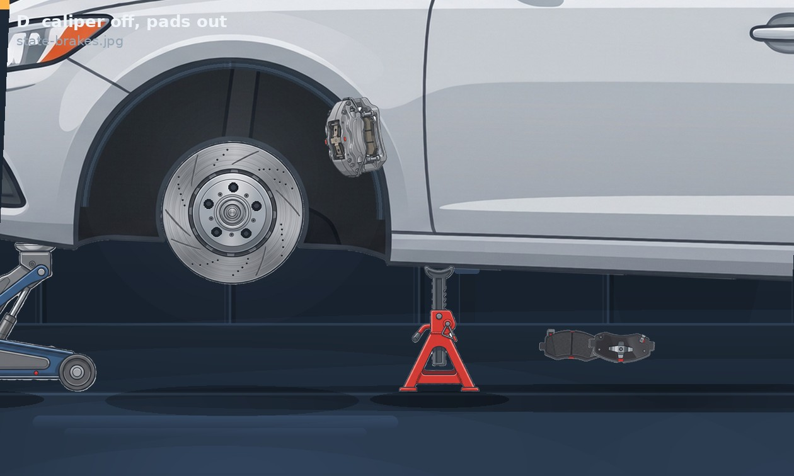
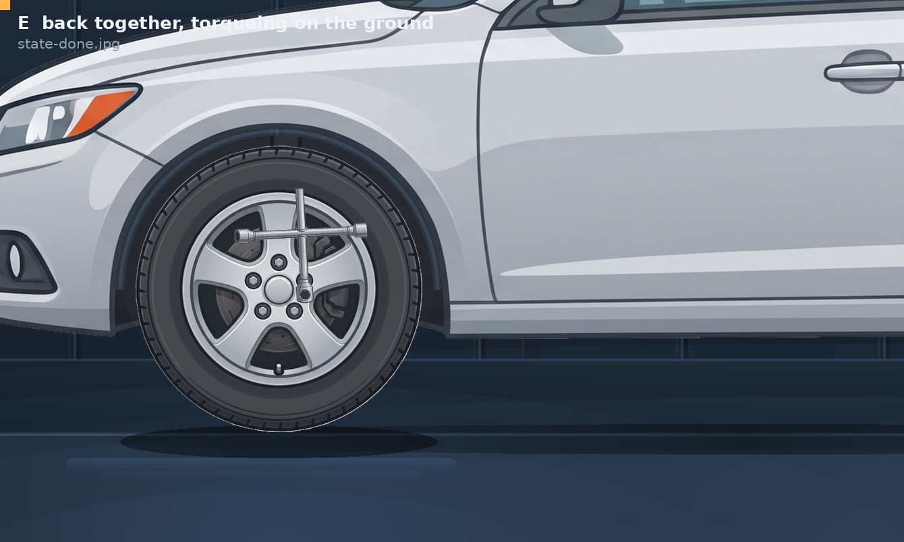

# Virtual Garage

A 2D car-maintenance simulator built from one set of illustrations: a saloon,
one alloy wheel, four brake parts, a jack, an axle stand and three hand tools.
You jack the car up, put it on a stand and take a wheel off; then you change the
brake pads; then the disc. Everything you see is cut from the source artwork —
nothing is redrawn.



*The dashboard: sections on the left, your level and XP in the header, the car in
the middle with the camera controls under it and the toolbox drawer on its right
edge, and the learning path on the right. The
lesson you are working through opens in place and holds its steps and hint.*

## Run it

No build step, no dependencies. Serve the folder with any static server:

```bash
cd virtual-garage
python3 -m http.server 8000        # then open http://localhost:8000
```

Opening `index.html` straight from disk also works in most browsers, but a
server is safer (some browsers refuse local file access to images).

## Using it

| | |
|---|---|
| **Learning path** | The rail on the right. Pick a card to start that lesson; the card opens in place with its steps, the current one highlighted, and a hint. |
| **Level & XP** | Every lesson pays XP once. Finish all four and you are on Level 3. Progress is kept in `localStorage`, so it survives a reload. |
| **Sidebar** | My Garage (free play), Lessons, Toolbox and Achievements are live; Settings is marked *soon*. Toolbox opens the drawer. |
| **Hover** | Any part lights up amber with its name tag — that is what is clickable. Lesson-highlighted parts glow blue and pulse. |
| **Toolbox** | The tab on the right edge of the stage (key `T`, or `1`–`4`): a drawer with the four tools, their pictures, what each is for, and which one the current step wants. Pick one, then use it on the car. Closing the drawer keeps the tool in your hand; `Esc` closes it too. |
| **Task panel** | The card at the bottom left of the stage. It names the current task, gives you one line of instruction, shows the tool in your hand, ticks off the steps and tells you what to click next. It follows the lesson on its own. Click its title for the full hint (`H` does the same). |
| **Hint** | Key `H`, or click the task panel's title, flashes the current hint in the open card. |
| **Work on the car** | With a tool in hand, click the highlighted part. The nuts are numbered while you are slackening them. |
| **Take things off** | Drag the wheel, caliper or disc away from the car — or click the wheel. Nothing moves until the job allows it: a wheel with nuts on it, or a car on a jack with no stand under it, will not budge — you get the reason instead. A short drag springs back. |
| **Put the wheel back** | The wheel you took off is standing on the floor beside the car. Click it: it lifts, slides onto the studs and lands centred, then *start all five nuts by hand* becomes the live step. It will not go on until the brakes behind it are back together. |
| **Look at things** | Click any part with no tool in hand to get a card with a picture of the part and an explanation of what it does. |
| **Camera** | Click any part and the camera frames it — no zooming about by hand. The ‹ button on the close-up chip undoes the last camera move (part → part → the lesson's own view); clicking the floor, double-clicking or `0` goes straight back to the lesson view. `+` / `−` and the wheel zoom from there, shift–drag pans. |
| **Free explore** | The task panel stays out of the way unless there is something to say — pick a tool and it tells you what that tool is for, then it goes quiet again. |
| **Start again** | The ↺ in the corner of the task panel puts the corner back the way it was. Shift-click also wipes XP and every tick. |

The four lessons run as one job, in the order a mechanic would do it:

1. **Lift safely and remove a wheel** — slacken the five nuts in a star pattern
   while the tyre is on the ground, slide the jack under the nose, pump, set the
   stand, release the jack, spin the nuts off, pull the wheel away.
2. **Replace the brake pads** — undo the two guide pins, lift the caliper off,
   pull the old pads, fit new ones, refit the caliper, tighten the pins.
3. **Replace the brake disc** — pull the disc, fit the new one, put the corner
   back together, lower the car.
4. **Refit and torque** — lift the wheel back onto the hub, start the nuts by
   hand, pump the jack to take the weight, pull the stand out, lower the car,
   then torque the nuts in a star pattern with the tyre on the ground.

Lessons 2–4 start from the state the previous one ends in, so you can jump
straight to the brakes or straight to the refit. "Free explore" is free play with
no gates at all. Finishing a lesson ticks its card, fills its bar and pays XP:
+250 for the lift, +250 for the pads, +200 for the disc, +300 for the refit.

| XP | Level | Rank |
|---|---|---|
| 0 | 1 | Apprentice Mechanic |
| 400 | 2 | Junior Technician |
| 1,000 | 3 | Mechanic |
| 1,800 | 4 | Master Technician |
| 2,800 | 5 | Shop Foreman |

The ring next to "Learning Path" counts the lessons you have finished, and the
toolbox and achievements sheets in the sidebar are built from the same state.

### The toolbox


The tools used to be a row of chips along the bottom. They are a drawer now, on the
right edge of the stage, because four tools with pictures, purposes and states
need more room than a 54-pixel strip:

* **The tab** stays on the edge of the stage and doubles as the drawer's handle.
  It carries a count of the tools and turns green when something is in your hand.
* **One tool at a time.** Picking a tool puts the previous one down, and picking
  the same one again puts it down altogether.
* **Availability.** The row the current step wants is outlined and marked
  *needed*; the rest are dimmed and marked *not yet*. In free play nothing is
  dimmed because everything is fair game.
* **Correct and incorrect.** Use the right tool and its row flashes green. Take
  a tool to a part it cannot touch — the jack at a wheel nut, say — and the row
  shakes while a toast names the tool that would have done the job.
* **Closing keeps the selection.** The drawer is for choosing, not for holding.
  The camera also gives the drawer its room: the view slides left by half the
  drawer's width while it is open, so the car is never hidden behind it.

### Removing a wheel

The wheel is the one part the whole first lesson builds up to, so it is gated
twice over. `CAN.wheel()` in `src/interactions/actions.js` is the single answer
to "may this come off?", and both the drag gesture and the effect ask it:

| State | What happens if you pull |
|---|---|
| Any nut still on the hub | It does not move. *"The nuts are still on — take all five off before pulling the wheel."* |
| All five off, car on the jack only | It does not move. *"Get the car on an axle stand first — never pull a wheel off a car the jack is holding."* |
| All five off, car on the stand | It comes off: it pulls off the hub, travels away and comes to rest on the floor beside the car. |

Nuts have the same treatment one level down: a nut will not come off until it
has been slackened, and it will not slacken twice. Each nut shows its own state —
slackened nuts back off along their stud and rotate, removed nuts fly away and
leave the stud bare — so you can see how far along you are without counting.

The wheel itself stays exactly where it is until the fifth nut has gone. When it
does come off it goes in three moves — off the studs towards you (it grows a
little), away from the car, then down — and it *stays there*: upright on its
tread at `L.wheelPark`, with its own contact shadow, still one sprite and still
part of the scene. Nothing is faded out, hidden or switched off, so there is
never a missing wheel, a greyed-out wheel or a second copy of one, and the camera
moves to the `wheelback` preset, which frames the empty corner and the wheel that
is waiting for it in the same shot.

### Putting it back on

Clicking the loose wheel is the whole interaction — no dragging needed (dragging
it near the hub still works, for anyone who reaches for it). `CAN.wheelOn()` is
the mirror of `CAN.wheel()` and asks the same kind of question:

| State | What happens if you click it |
|---|---|
| Caliper hanging off the disc | It stays on the floor. *"The caliper is hanging off the disc…"* |
| Pads still out | *"The pads are still out…"* |
| Disc off the hub | *"The disc is off the hub. Fit it before the wheel goes back on."* |
| A nut left on a stud | *"There are nuts on the studs — spin them off before the wheel goes on."* |
| Corner rebuilt | It lifts off the floor, stands up in front of the hub, slides onto the studs, and lands dead centre. |

The state is three words, not eight numbers: `VG.geom.wheelState(S)` answers
`mounted` (on the hub, every offset zero), `loose` (off, on the floor, clickable)
or `moving` (mid-animation, so nothing else may touch it). The last frame of the
fit hard-sets `dx = dy = rot = 0, scale = 1` and then renders, so "aligned with
the hub" is exact rather than wherever an easing curve stopped.

### One answer to "is the wheel on?"

There is exactly one copy of that fact — `S.wheel` — and one way to ask:

| Question | Who answers it |
|---|---|
| May the wheel come off? | `CAN.wheel(S)` — asks `wheelState()` first |
| May it go back on? | `CAN.wheelOn(S)` — asks `wheelState()` first |
| May a nut be started? | `EF.nutFit` — anything but `mounted` is refused |
| Can the caliper come off? | `CAN.caliper` — needs `loose` |
| May I drag it? | `draggableKind` — only when it is not `moving` |
| What does the panel say? | `hud.updatePanel()` — reads `wheelState()` |

No `wheelMounted`, no `wheelInstalled`, no second flag hiding in the renderer:
`removed`, `busy` and `resting` are the raw numbers behind that one function, and
every check goes through it. That is why a mounted wheel and a playable nut can
no longer disagree.

### Bare studs are live targets

Each nut is two things in one group: the **stud**, which belongs to the hub face
and never moves, and the **nut**, which flies off and comes back. Before this fix
the whole group went `display:none` when a nut came off — so with the wheel back
on and five nuts to start, there was nothing under the pointer at the studs but
the wheel's own 228-unit hotspot. The click became a wheel click, the lesson
refused it with *"the wheel needs to be on its studs before the nuts go back"*,
and the nuts could not be started at all. The group now stays put and keeps its
26-unit hotspot; only the nut art is hidden at the end of its flight. The stud,
its hover name and the star-pattern badge are all still there, on all five.

A slow fit cannot jump the lesson queue either: `EF.wheelOn` marks its own
action `__deferred`, so the engine does not advance the step until the wheel has
actually landed and `removed` has gone false. That is what keeps *start all five
nuts by hand* locked while the wheel is still in the air — and it means the refit
lesson's second step only lights up once its first one is genuinely finished.

That state is per wheel. `state.js` keeps `nuts` (front) and `nutsRear` (rear),
and `VG.geom.nutsFor(S, axle)` is the only way the renderer reaches either, so a
front action can only ever animate front nuts — the rear corner keeps its five
nuts and its wheel whatever happens at the front. The rear is inspect-only: its
parts still answer a click with a card, but they are not draggable and no lesson
acts on them.

## The task panel

Everything that used to sit along the bottom of the stage — a preset row, zoom
buttons, a Reset button and a line of state counts — is gone. It read as a
developer's console, not a workshop. What is left is one card in the bottom-left
corner, and it only appears when there is a job to do:

| Part of the card | Where it comes from |
|---|---|
| `Step 3 of 7 · 3 of 6 done` | `engine.stepIndex`, `lesson.steps.length`, `engine.progress` and the step's `need` |
| the pips | one per step: blue when behind you, bright for the one you are on |
| the title | the step's own `label` |
| the instruction | the first sentence of the step's `hint` — the rest stays in the rail |
| the tool chip | `S.tool`; the step's `tool` is shown amber when it is not the one in your hand |
| the next line | `NEXT[step.accept[0]]`, or "take the *X* from the toolbox" when the tool is missing |

It is placed bottom-left because that corner of the stage is floor and empty
air at every camera preset — the car, the wheel and the jack all sit higher or
further right. In free explore it hides itself and only speaks when a tool is in
hand. Nothing on the stage is interactive except the car, the parts, the toolbox
tab and this card.

## The camera

You should never have to hunt for a part with the scroll wheel. Every hotspot
is also a camera move:

| Click | What happens |
|---|---|
| The wheel, hub, disc, caliper, pads, guide pins | The view swings in on that part, sized so it fills about half the frame, and its info card opens |
| A nut | Close on the stud pattern |
| The jack, the stand, the jacking or standing point | Frames the tool where it stands |
| A part you have taken off | Frames it where it now lies, not where it came from |
| The empty floor, or a double-click | Back to the view the lesson wants |
| `+` `−` or the wheel | Smooth zoom about the pointer, clamped to 320–4,600 world units |

The chip in the top-left corner names what you are looking at and gives you a ‹
button back. It names the part and nothing else — no zoom factors, no numbers.
`VG.camera.back()` walks a small history: every framing move pushes the view it
leaves, so disc → wheel → the lesson's view all work backwards, and a lesson
setting its own view clears the trail. Zoom left on its own is deliberately
*not* needed: the whole loop — see a part, read it, work on it, come back — is
clicks.



*Every hotspot's framing, rendered from the same camera code the app runs.*
Achievements are not stored — they are derived from a small counter of what your
hands have actually done (nuts slackened, car lifted, stand set, wheel off,
caliper off, pads swapped, disc off, nuts torqued, lessons started), so the
Achievements sheet can never disagree with your save. Earning one pops a toast.
Finishing a lesson also fires a little confetti and counts the XP up in the
victory card.



*The framing the app cuts to when you take the wheel off yourself: the empty
corner on the right, the wheel you took off standing on the left, one click away
from going back on.*



## The workshop

The room behind the car is not a photograph or a screenshot: it is a list of
about 650 plain shapes in the same world coordinates as the car, so it pans,
zooms and focuses with it.

* `tools/make_garage.py` writes the list to `src/content/garage.js` — cladded
  wall panels with folded seams, the ceiling line and its soffit, four LED
  battens with their bloom and light cones, a pegboard with tools hung on it, a
  hose reel, a clock, a jobs board, conduits, shelving, tyre racks leaning
  against the wall, the kick plate, the floor with its seams, bay markings and
  pools of light.
* `src/scene/garage.js` turns that list into one SVG group in the app.
* `tools/garage_paint.py` paints the same list in Pillow for the stills, with the
  same fill rules (a two-colour fill is a vertical gradient on a box and a radial
  glow on an ellipse).

Because both renderers read one list, the pictures in this README and the app
cannot drift apart. The lamps sit just under the frame's top edge at the default
zoom — the overview only shows about 630 world units above the car's roof — so
the light reads as a ceiling fitting however the stage is cropped. The whole
group is `pointer-events:none`, so the room never swallows a click.

Three bugs came out of building it this way: the stills renderer was drawing the
contact shadows in world coordinates onto an image-space canvas (they floated on
the wall), the palette was so dark that nothing read, and the wall fittings were
sitting behind the car instead of above its roof line.

An arch with the wheel out of it is a hole in the bodywork, so each arch also
gets a liner painted inside it (`wheelWell()` in `src/scene/scene.js`): a radial
light falloff from the top lip plus three arcs at the lip — shadow, mid, highlight
— at `WELL_R = 241`, which is just inside the 246-unit arch cut-out measured off
`car.png`. It lives inside the car group, behind the hub, disc, pads and caliper,
so it pitches with the body and is hidden again as soon as the wheel goes back on.
`tools/preview_states.py` paints the same liner with the same radius, so the
stills keep telling the truth.

## How the artwork is used

The source images are 12 JPEGs on a white background — no transparency, no
layers. `tools/prepare_assets.py` turns them into sprites:

* **Background removal** by flood-filling the white studio backdrop in from the
  border, so white highlights *inside* a part survive.
* **Real holes punched** — the disc bore, the axle-stand triangle, the jack
  linkage gap and the caliper bracket gap are genuinely see-through.
* **One wheel for both axles.** The two wheel files are byte-identical, so the
  rear axle reuses the front sprite.
* **The five lug nuts are separate sprites.** The wheel is 5-fold symmetric, so
  the nuts are lifted out and the gaps behind them filled from the wheel face.
  That is what lets a nut come off while the wheel stays on.
* **The jack is split into a chassis and a moving arm.** The cut follows a
  circle around the arm pivot, so the seam stays closed when the arm swings down
  and the car settles onto its wheels.
* **The garbled sidewall lettering is erased** by repainting the tyre from its
  own radial colour profile, leaving the moulded rings and the valve stem.

Everything is placed in one coordinate system: **one world unit = one pixel of
`car_body.jpeg`**. Axles at (605, 962) and (2286, 962), ground at y = 1174, tyre
radius 212. Because the wheel, disc and hub share one 5-stud pattern, lining
their studs up fixes their relative scales (disc = 0.53 × wheel, hub = 0.25 ×
wheel) — nothing is eyeballed. `docs/asset-inventory.md` has every measurement.





The brake view is a camera zoom of the same scene, not a separate drawing:
the wheel-end stack is hub → disc → pads → caliper → wheel → nuts, drawn once
per axle and revealed as the parts come off.

## Layout

```
virtual-garage/
├── index.html                  shell: sidebar, header, stage card, rail
├── styles/main.css             the dark dashboard theme
├── assets/
│   ├── source/                 the 12 originals, untouched
│   └── sprites/                cut-outs + anchors, generated
├── src/
│   ├── content/
│   │   ├── sprites.js          sprite manifest (generated)
│   │   ├── layout.js           every world number, in one place
│   │   ├── lessons.js          the four lessons and their steps
│   │   ├── parts.js            part descriptions for the info cards
│   │   └── garage.js           the room: ~650 shapes (generated)
│   ├── core/
│   │   ├── util.js             DOM + tween helpers
│   │   ├── sprite.js           sprite instances and anchors
│   │   └── state.js            world geometry + the state object
│   ├── scene/
│   │   ├── scene.js            builds the SVG, renders state
│   │   ├── garage.js           turns the room's shape list into SVG
│   │   └── camera.js           framing, zoom about a point, back history
│   ├── interactions/actions.js gestures -> actions -> effects
│   ├── lessons/engine.js       step order, gating, progress
│   ├── ui/
│   │   ├── progress.js         XP, levels, ranks, achievements, storage
│   │   ├── hud.js              sidebar, header, task panel, toolbox, path
│   │   └── partcard.js         the part info card
│   └── main.js                 boot + render loop
├── tools/
│   ├── prepare_assets.py       source JPEGs -> sprites + manifest
│   ├── make_garage.py          writes the room's shape list
│   ├── garage_paint.py         paints that list for the stills
│   ├── preview_states.py       renders the scene states to docs/*.jpg
│   └── preview_ui.py           renders the whole window to docs/ui-check.jpg
├── tests/smoke.js              headless play-through of all lessons
└── docs/                       measurements, fit check, state renders
```

Plain ES5-flavoured JavaScript in classic `<script>` tags — no modules, no
bundler, no runtime dependencies. The renderer is a pure function of the state
object, so an interrupted animation can never leave the scene inconsistent.

## Regenerating things

```bash
python3 tools/prepare_assets.py     # assets/source -> assets/sprites + manifest
python3 tools/make_garage.py        # src/content/garage.js (the room)
python3 tools/preview_states.py     # docs/state-*.jpg
python3 tools/preview_ui.py         # docs/ui-check.jpg (the window mock-up)
node tests/smoke.js                 # plays all four lessons headlessly
```

`prepare_assets.py` needs Pillow, NumPy and OpenCV; the app itself needs
nothing.

## What the test actually covers

`node tests/smoke.js` stubs a small DOM, loads the real `src/` modules in the
order `index.html` loads them, and runs 455 assertions: every sprite file
exists, the stud pattern and saddle heights match, all four lessons play
through to the completion card, out-of-order actions are refused (torqueing
before the car is down, pumping before the stand is out, nuts before the
wheel), the star pattern is enforced, the real click path is driven through the
rendered DOM (a click on a nut means *fit* in the refit lesson and *torque*
once the car is down; the rear axle stays inert), the wheel cannot be pulled off
on any route — not with nuts on, not with four off, not with the car held by the
jack alone, not from a single click and not from a drag — the front wheel is
followed nut by nut (each slackening moves that nut and no other, each removal
takes that nut and leaves the wheel on), the rear corner is snapshotted before
and after every one of those steps and must come out byte-identical, and the
removal animation is sampled frame by frame to prove the wheel travels away from
the car monotonically and is never dropped from the drawing; the toolbox lists four tools, marks the one the step wants, keeps a
single selection and keeps it when the drawer closes, both arches carry the painted liner and the
wheel-well gradient it needs, the camera frames the right
thing from every hotspot, keeps the anchor point still while zooming, clamps at
both ends and comes back on request — including part → part → lesson view through
the one ‹ button — and the HUD renders a hint and an action button at every step.
The wheel loop has a block of its own: all five nuts off by click, jack, stand,
release, the wheel off by a click and parked at exactly `L.wheelPark`, still
drawn, still grabbable, still one node; the fit refused with the caliper off, then
with the disc off (and told why each time); the corner rebuilt and the fit
allowed; two more clicks while it is in the air starting nothing and moving it
nowhere; the flight sampled frame by frame to prove it only ever closes on the
hub and that it ends on `translate(0 0) rotate(0) scale(1)` with every number
exactly zero; the nut step live again afterwards; and in the refit lesson, the
step index staying at 0 while the wheel is airborne and moving to *nuts by hand*
only once it has landed.

The pointer has a block of its own, because calling `clickNode` directly can
never catch a hit-testing bug: it walks the `[data-hit]` nodes in document order —
the way SVG paints them, topmost last — and asks what the pointer would actually
land on at each stud, with the wheel mounted and its nuts off. Five nuts on five
bare studs, each one its own index; five clicks made through *those* nodes start
all five nuts and move the lesson on; and a click on the mounted wheel itself
leaves it exactly where it is, never says a word about studs, and answers with
the part card.

The task panel has its own block: that no debug read-out, camera preset row, zoom
button or Reset button exists anywhere in the DOM; that the panel names the step
and the task, gives one sentence, shows a pip per step with only the current one
lit, shows the tool actually in hand (amber when it is the wrong one, with the
next line naming the tool to fetch), counts repeated work in words ("3 of 5
done"), follows the lesson to the next step on its own, says "Corner finished"
when there is nothing left, keeps a restart control that really does put the
corner back, stays hidden in free explore until a tool is picked up and hides
again when it is put down, and never contains a degree sign, a times sign, a
`5L/0R`-style count or a pitch angle.

It cannot see pixels. The layout, the CSS and the feel of the gestures are
checked by `tools/preview_states.py` and `tools/preview_ui.py`, which redraw the
scene and the whole window from the same numbers the app uses, and by reading
the code — not by a browser. Found that way: the lesson panel and the camera bar
were both pinned top-right and overlapped, the panel was too transparent to read
over the white bodywork, the parked disc landed underneath the panel once the
panel moved to the right, the step chip and the toast both wanted the top-left
corner, and the jack arm in the stills was being anchored on its pivot instead of
its own anchor (a bug in the previewer, not the app).

## Known limits

* The wheel artwork has a brake disc and caliper painted behind its spokes. That
  is invisible while the wheel is on (the parts it hides are the ones you are
  looking at once it is off), so it was left alone.
* The caliper is a three-quarter view drawn over a face-on wheel end. It reads
  correctly as an overlay but is not a true projection.
* The jack and the stand are drawn in single poses; the jack arm swings on its
  pivot and the stand is stretched to the exact sill height, which is a
  couple of percent of distortion.
* One wheel end is fully modelled. The rear axle carries the same stack and is
  visible, but its parts are not yet interactive: lifting the rear needs a
  mirrored jack and a second support point, which is the next piece of work.
